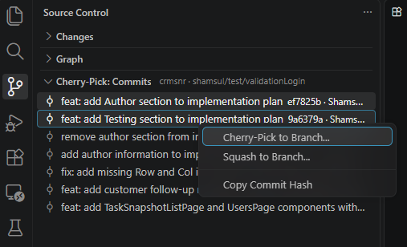

# Git Cherry-Pick & Squash

Cherry-pick or squash commits across branches from the Source Control panel.

## Where to find it

Open the **Source Control** panel → **Cherry-Pick: Commits** section. Select one or more commits (Ctrl/Shift+click), right-click, and choose **Cherry-Pick to Branch...** or **Squash to Branch...**.



## Features

- A **Cherry-Pick: Commits** view in the SCM panel listing commits of the viewed branch (multi-select supported).
- Right-click selected commits → **Cherry-Pick to Branch...**, choose a destination branch (local or remote — remote branches create/checkout a tracking local branch).
- Commits are applied one by one, oldest first.
- On conflict the operation pauses: conflicted files open in the editor, and a status bar item plus a notification offer **Continue**, **Skip**, and **Abort**.
- **Continue** verifies conflict markers are gone, stages resolved files, and runs `git cherry-pick --continue` — then resumes the queue. If you already committed the resolution yourself, Continue detects that and moves on.
- **Skip** discards the current commit and continues with the rest.
- **Abort** stops the in-progress cherry-pick. Note: `git cherry-pick --abort` only undoes the *current* commit — commits already applied stay on the target branch (the abort confirmation tells you how many).
- If the workspace reloads mid-operation, the unfinished queue is restored on activation.
- **Create a new destination branch** right from the branch picker: *Create new branch from current branch* or *Create new branch from...* (any local or remote branch). Names are validated as you type, and branches created from a remote branch don't track it.

### Squash to Branch

- Right-click selected commits → **Squash to Branch...** to combine them into a **single commit** on the destination branch (existing or new, same picker as cherry-pick).
- Enter the commit subject (prefilled); the body automatically lists the squashed commits:
  ```
  Squash of 3 commits

  Squashed commits:
  - a1b2c3d first change
  - d4e5f6a second change
  - 0718293 third change
  ```
- Commits are applied oldest first with the same conflict flow (**Continue** / **Skip** / **Abort**); when the queue finishes they are collapsed into one commit (`git reset --soft` to the starting point, then one `git commit`).
- **Skip** leaves that commit out of the squash.
- **Abort** is all-or-nothing: the branch is reset to where the squash started, including commits already applied.
- If every change is already on the destination, no commit is created ("Nothing to squash").
- The squash commit is authored by you.

## Author
Shamsul Saleh

### Penerangan dalam Bahasa Melayu

# Git Cherry-Pick & Squash

Lakukan cherry-pick atau squash commit antara branch melalui panel Source Control.

## Ciri-ciri

- Paparan **Cherry-Pick: Commits** dalam panel SCM menyenaraikan commit daripada branch yang sedang dilihat (pemilihan berbilang commit disokong).
- Klik kanan pada commit yang dipilih → **Cherry-Pick to Branch...**, kemudian pilih branch destinasi (tempatan atau jauh — branch jauh akan mewujudkan atau checkout branch tempatan yang menjejakinya).
- Commit digunakan satu demi satu, bermula dengan yang paling lama.
- Jika berlaku konflik, operasi akan dijeda: fail yang berkonflik dibuka dalam editor, dan item bar status serta pemberitahuan akan menawarkan pilihan **Continue**, **Skip** dan **Abort**.
- **Continue** mengesahkan bahawa penanda konflik telah dibuang, menambah fail yang telah diselesaikan ke staging, kemudian menjalankan `git cherry-pick --continue` dan menyambung semula giliran commit. Jika anda telah membuat commit penyelesaian konflik sendiri, Continue akan mengesannya dan meneruskan proses.
- **Skip** membuang commit semasa daripada proses dan meneruskan commit yang selebihnya.
- **Abort** menghentikan cherry-pick yang sedang berjalan. Nota: `git cherry-pick --abort` hanya membatalkan commit *semasa* — commit yang telah digunakan sebelum itu kekal pada branch sasaran (pengesahan pembatalan akan memaklumkan jumlahnya).
- Jika ruang kerja dimuat semula semasa operasi berlangsung, giliran yang belum selesai akan dipulihkan apabila sambungan diaktifkan semula.
- **Create a new destination branch** membolehkan anda mencipta branch destinasi terus daripada pemilih branch: *Create new branch from current branch* atau *Create new branch from...* (mana-mana branch tempatan atau jauh). Nama branch disahkan semasa anda menaip, dan branch yang dicipta daripada branch jauh tidak akan menjejakinya.

### Squash ke Branch

- Klik kanan pada commit yang dipilih → **Squash to Branch...** untuk menggabungkannya menjadi **satu commit** pada branch destinasi (sedia ada atau baharu, menggunakan pemilih yang sama seperti cherry-pick).
- Masukkan subjek commit (diisi secara automatik); isi commit akan menyenaraikan commit yang digabungkan:
  ```
  Squash of 3 commits

  Squashed commits:
  - a1b2c3d first change
  - d4e5f6a second change
  - 0718293 third change
  ```
- Commit digunakan satu demi satu, bermula dengan yang paling lama, dengan aliran penyelesaian konflik yang sama (**Continue** / **Skip** / **Abort**). Setelah semua commit diproses, semuanya digabungkan menjadi satu commit (`git reset --soft` ke titik permulaan, kemudian satu `git commit`).
- **Skip** tidak memasukkan commit tersebut dalam squash.
- **Abort** membatalkan keseluruhan operasi: branch ditetapkan semula kepada keadaan sebelum squash bermula, termasuk commit yang telah digunakan.
- Jika semua perubahan sudah ada pada branch destinasi, tiada commit baharu akan dibuat ("Nothing to squash").
- Commit squash akan menggunakan nama anda sebagai pengarang.

## Author
Shamsul Saleh